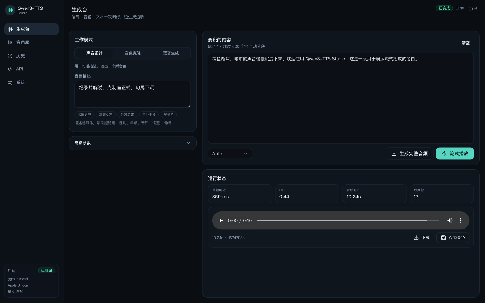
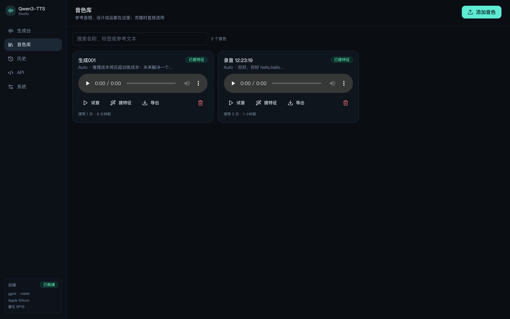
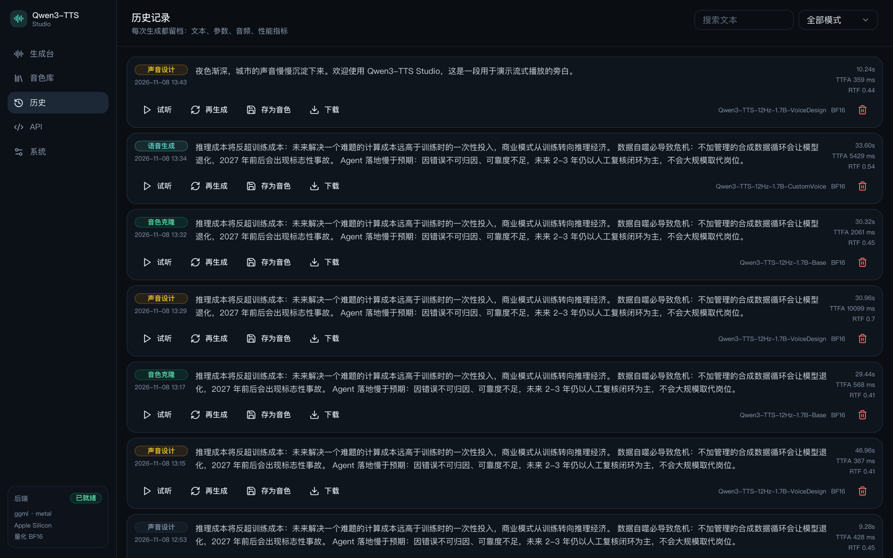
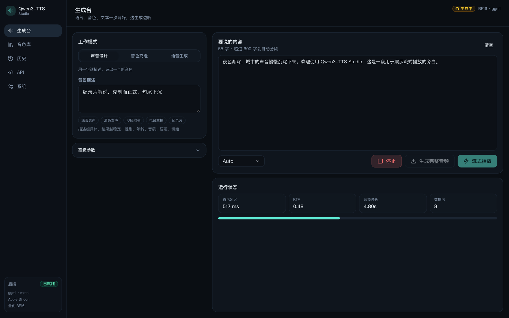
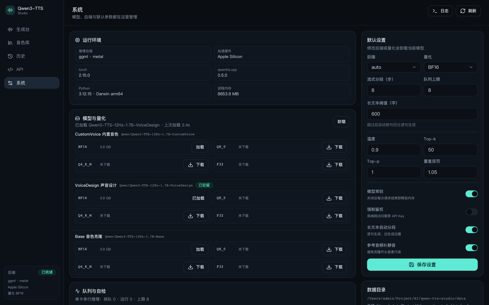
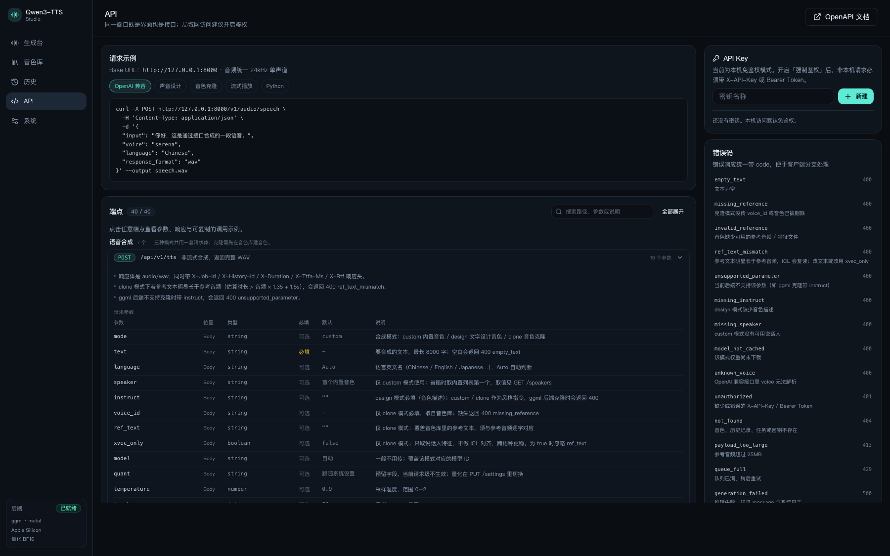

# Qwen3-TTS Studio

<p>
  
  
  
  
  
</p>

本地运行的个人语音工作台：**声音设计**、**音色克隆**、**内置音色语音生成**三种模式，浏览器里边生成边听，同时对外提供 HTTP / WebSocket API。

单进程、单端口、零账号——`uv run qwen-tts-studio` 之后打开 <http://127.0.0.1:8000> 就能用。推理走 [faster-qwen3-tts](https://github.com/andimarafioti/faster-qwen3-tts)：macOS 用 ggml + Metal，Windows / Linux 用 torch CUDA Graphs（Linux 也可用 ggml cu128 轮子）。后端 FastAPI，前端 React + Tailwind（shadcn/ui 风格组件）。

<p align="center">
  
</p>

## 目录

- [功能](#功能)
- [截图](#截图)
- [快速开始](#快速开始)
- [使用说明](#使用说明)
- [HTTP API](#http-api)
- [平台与后端](#平台与后端)
- [模型与量化](#模型与量化)
- [性能](#性能)
- [配置](#配置)
- [开发](#开发)
- [常见问题](#常见问题)
- [已知限制](#已知限制)

## 功能

**三种合成模式**（模型按需加载，LRU 常驻，同一时刻只保留一个）

| 模式 | 模型 | 输入 | 典型场景 |
| --- | --- | --- | --- |
| 声音设计 | `Qwen3-TTS-12Hz-1.7B-VoiceDesign` | 一段音色描述 | 还没有素材，先用一句话造个音色 |
| 音色克隆 | `Qwen3-TTS-12Hz-1.7B-Base` | 参考音频（+ 参考文本） | 复刻某个说话人 |
| 语音生成 | `Qwen3-TTS-12Hz-1.7B-CustomVoice` | 内置说话人 + 风格指令 | 直接出活 |

**流式播放**：WebSocket 推 PCM16，浏览器 WebAudio 按 playhead 排队无缝播放，模型已驻留时端到端首包 300–500ms；随时「停止」，取消在几百毫秒内生效。

**长文本**：超过阈值（默认 600 字）自动按句切分，逐句生成、连续播放，最后合成一个完整 WAV。

**音色库**：上传 / 拖拽 / 浏览器录音入库，自动转 24kHz 单声道；ggml 后端会顺手预提取 `.spk` / `.rvq` 参考特征，克隆时跳过参考编码。

**历史记录**：文本、参数、音频、首包延迟 / RTF / 时长全留档，支持试听、下载、再生成、存为音色。

**系统页**：模型 × 量化矩阵、带进度的下载、加载 / 卸载、后端与量化切换、队列与自检、日志弹窗。

**对外接口**：`/api/v1/*` REST + `/api/v1/ws/tts` WebSocket，另有 OpenAI 兼容的 `/v1/audio/speech`（可直接指给现有客户端），可选 API Key 鉴权，Swagger 在 `/docs`。

## 截图

| 音色库 | 历史记录 |
| --- | --- |
|  |  |

| 流式生成中 | 系统与模型管理 |
| --- | --- |
|  |  |

API 页内置可直接复制的 curl / Python 示例与 API Key 管理：

<p align="center">
  
</p>

## 快速开始

### 环境要求

- Python **3.12+**
- [uv](https://docs.astral.sh/uv/)（依赖与虚拟环境管理）
- Node **20+** 与 [pnpm](https://pnpm.io/)（只在构建前端时需要）
- 模型权重约 **3.9GB / 模型**（bf16 单档），按需下载

### 安装

```bash
git clone <this-repo> && cd qwen-tts-studio

# 1. 后端依赖
uv sync

# 2. 构建前端（产物直接输出到 src/qwen_tts_studio/static，由后端托管）
cd frontend && pnpm install && pnpm build && cd ..
```

`pyproject.toml` 默认把软件源指向清华镜像，海外环境可删掉 `[[tool.uv.index]]` 一节。

### 启动

```bash
uv run qwen-tts-studio            # 默认 127.0.0.1:8000，自动打开浏览器
uv run qwen-tts-studio --port 8080 --no-browser
uv run qwen-tts-studio --backend torch --quant Q8_0   # 临时覆盖后端与量化
```

打开 <http://127.0.0.1:8000> 即是工作台，同一个端口同时提供页面与 API。

### 首次使用

1. 进「系统」页，在**模型与量化**里给要用的模型点「下载」（ggml 权重来自 `Serveurperso/Qwen3-TTS-GGUF`，talker 与 tokenizer 必须同量化档，界面会一起下）。
2. 下载完成后点「加载」，或者直接在生成台发一次请求——模型会自动加载，首次约 5–7 秒（Metal kernel 编译），之后常驻复用。
3. 换后端 / 量化会卸载当前模型，下一次请求重新加载。

想改前端、要热更新？见 [开发](#开发)。

## 使用说明

### 声音设计

左侧「音色描述」写清**性别、年龄、音质、语速、情绪**，描述越具体结果越稳定；下方预设 chips 是几个可直接用的起点。点「流式播放」边生成边听，满意后「存为音色」——后续克隆模式就能直接复用这个音色。

### 音色克隆

1. 先在「音色库」上传参考音频（10–30 秒干净人声最好），填上**参考文本**（音频里说的原话）。
2. 生成台切到「音色克隆」，选中该音色即可合成。
3. 参考文本与音频严格对应时质量最好；勾选「仅用说话人特征」走 x-vector 路径，跨语言更干净，且不需要参考文本。
4. 音色卡片上的「提特征」会预提取 `.spk` / `.rvq`，克隆时跳过参考编码（需要 Base 模型已下载）。
5. 参考音频超过 30 秒会在 30 秒前的停顿处收尾（不会把字切一半），参考文本会同步收敛到这段音频能容纳的长度；文本明显比音频长时不再硬合成，而是报 `ref_text_mismatch`——ICL 克隆把参考音频当上下文，文本对不齐就会把旧文稿念出来。没有参考文本的音色会自动改走 x-vector。

> ggml 后端不支持克隆模式下的风格指令（qwentts.cpp 限制），该输入框会自动禁用；需要给克隆加情绪、语速，切到 torch 后端。

### 语音生成

选内置说话人（`serena`、`vivian` 等），在「风格指令」里补一句要求，例如「语速稍快，带一点兴奋」。这是唯一可以只靠指令控制风格的模式。

### 音色库 / 历史 / 系统

- **音色库**：卡片式管理，可试音、提特征、导出 zip、删除；上传支持拖拽与浏览器录音（自动重采样到 24kHz）。
- **历史**：按模式筛选、按文本搜索，支持试听、再生成（同参数重跑）、存为音色、下载原始 WAV；「清理」可按 7/30/90 天或指定日期批量删除记录与音频（先预览条数与占用空间，最近 1 分钟内的记录不会被删）。
- **系统**：运行环境、模型矩阵、队列与自检、日志弹窗、默认参数（后端 / 量化 / 分段步长 / 队列上限 / 采样参数 / 常驻与鉴权开关）。

## HTTP API

完整定义见运行中的 `/docs`（Swagger）或 `/openapi.json`；应用内「API」页按功能分组列出全部端点，可展开查看**逐个参数（位置 / 类型 / 必填 / 默认 / 说明）**、响应头与错误码，并复制 curl / Python 示例。

| 方法 | 路径 | 说明 |
| --- | --- | --- |
| POST | `/api/v1/tts` | 非流式合成，返回 WAV，响应头带 `X-History-Id` / `X-Ttfa-Ms` / `X-Rtf` / `X-Duration` |
| POST | `/api/v1/tts/stream` | chunked 裸 PCM（`audio/L16`，24kHz 单声道） |
| WS | `/api/v1/ws/tts` | 流式双向：JSON 文本帧 + 二进制 PCM 帧，可随时发 `{"type":"cancel"}` |
| POST | `/api/v1/tts/cancel/{job_id}` | HTTP 侧取消 |
| GET | `/api/v1/jobs/{job_id}` | 任务状态与统计 |
| GET | `/api/v1/speakers` · `/languages` | 内置说话人 / 语言列表 |
| GET | `/api/v1/voices` · `POST` | 音色列表 / 上传（multipart） |
| PATCH · DELETE | `/api/v1/voices/{id}` | 改名、删除 |
| GET | `/api/v1/voices/{id}/audio` · `/export` | 原声 / zip 导出 |
| POST | `/api/v1/voices/{id}/sample` · `/prepare` | 试音 / 预提取参考特征 |
| GET | `/api/v1/history` | 分页列表（`page` / `page_size` / `mode` / `query`） |
| GET · DELETE | `/api/v1/history` | `DELETE ?before=<unix秒>` 按时间批量清理记录与音频 |
| GET | `/api/v1/history/preview` | 清理预览：`?before=<unix秒>` 返回条数、音频数、占用字节 |
| GET | `/api/v1/history/{id}` · `/audio` · `/download` | 详情 / 音频（支持 Range）/ 下载 |
| POST | `/api/v1/history/{id}/regenerate` | 同参数重新生成 |
| GET | `/api/v1/system/info` · `/models` · `/queue` | 运行环境、模型矩阵、队列 |
| GET | `/api/v1/health` · `/version` | 健康检查 / 版本（免鉴权） |
| POST | `/api/v1/system/models/load` · `/unload` · `/selftest` | 加载 / 卸载 / 自检 |
| GET | `/api/v1/system/models/download` | SSE 下载进度 |
| GET · DELETE | `/api/v1/system/logs` | 读取尾部 / 清空日志 |
| GET · PUT | `/api/v1/settings` | 读取 / 更新默认设置 |
| GET · POST · DELETE | `/api/v1/apikeys` | API Key 管理 |
| POST | `/v1/audio/speech` | OpenAI 兼容语音合成 |
| GET | `/v1/audio/voices` | OpenAI 兼容音色列表 |

示例：

```bash
# 非流式：拿一个 WAV
curl -X POST http://127.0.0.1:8000/api/v1/tts \
  -H 'Content-Type: application/json' \
  -d '{"mode":"custom","text":"你好，世界。","speaker":"serena","language":"Chinese"}' \
  -o out.wav

# 流式：裸 PCM 直接喂给播放器
curl -N -X POST http://127.0.0.1:8000/api/v1/tts/stream \
  -H 'Content-Type: application/json' \
  -d '{"mode":"design","text":"夜色渐深。","instruct":"温暖沉稳的男声旁白","language":"Chinese"}' \
  --output - | ffplay -f s16le -ar 24000 -ac 1 -

# OpenAI 兼容
curl -X POST http://127.0.0.1:8000/v1/audio/speech \
  -H 'Content-Type: application/json' \
  -d '{"input":"你好，世界。","voice":"serena","language":"Chinese"}' -o out.wav

# 上传参考音色
curl -X POST http://127.0.0.1:8000/api/v1/voices \
  -F file=@ref.wav -F name="我的音色" -F ref_text="参考音频里说的原话" -F language="Chinese"
```

`voice` 取值：内置说话人名（`serena` 等）、`voice:<音色ID>`、`design:<描述>`。

鉴权默认关闭，且**回环地址始终免鉴权**；只在从局域网访问时需要在请求头带 `X-API-Key`（Key 在「API」页创建）。

## 平台与后端

| 平台 | 推荐后端 | 说明 |
| --- | --- | --- |
| macOS 14+（Apple Silicon） | `ggml` | Metal 加速，自动选择；不支持克隆 + 风格指令 |
| Windows 10/11 + NVIDIA | `torch` | `qwentts-cpp-python` 没有 Windows 轮子，ggml 需 WSL2 / Docker |
| Linux + NVIDIA | `torch` 或 `ggml` | ggml 需要 cu128 轮子；显存紧张时优先 ggml |
| 无 GPU | `ggml`（CPU） | 能跑，但明显慢 |

`backend=auto` 时按平台自动选：Darwin 走 ggml，其余走 torch。系统页可随时切换后端与量化，切换会卸载当前模型。

## 模型与量化

ggml 权重来自 `Serveurperso/Qwen3-TTS-GGUF`，提供 `BF16` / `Q8_0` / `Q4_K_M` / `F32` 四档：

| 量化 | 单模型体积 | 建议 |
| --- | --- | --- |
| BF16 | ≈ 3.9GB | 默认，质量最好 |
| Q8_0 | ≈ 2.1GB | 几乎无损，内存吃紧时首选 |
| Q4_K_M | ≈ 1.2GB | 省内存，音质略有损失 |
| F32 | ≈ 7.8GB | 仅用于对比 |

`torch` 后端直接用 HuggingFace 上的原始权重，没有量化档位。

## 性能

Apple Silicon（M 系）/ ggml / BF16 / 1.7B 实测：

| 场景 | 结果 |
| --- | --- |
| 冷启动加载模型 | 5–7s（Metal kernel 首次编译），常驻内存约 0.9GB KV cache |
| 端到端首包（模型已驻留） | 360–460ms |
| 非流式 RTF | ≈ 0.45（2s 音频约 0.9s 生成） |
| 流式 RTF | 0.41–0.7（含分段解码开销） |
| 取消延迟 | ≈ 280ms（发出 cancel 到停止出声，含已生成片段落盘） |
| 16 字中文 | 约 5.8s 音频，10 个数据包 |

> RTF = 处理耗时 / 音频时长，小于 1 表示快于实时。首次请求包含模型加载，指标会明显偏高。

## 配置

设置写在 `data/settings.json`，界面「系统 → 默认设置」可改，也可用环境变量覆盖（前缀 `QTS_`）：

| 变量 | 说明 |
| --- | --- |
| `QTS_DATA_DIR` | 数据目录，默认 `./data` |
| `QTS_HOST` / `QTS_PORT` | 监听地址与端口 |
| `QTS_BACKEND` | `auto` / `ggml` / `torch` |
| `QTS_QUANT` | `BF16` / `Q8_0` / `Q4_K_M` / `F32` |
| `QTS_AUTH_REQUIRED` | 是否强制 API Key（回环地址始终免鉴权） |
| `QTS_KEEP_MODEL_LOADED` | 是否常驻模型 |
| `QTS_HF_ENDPOINT` | HuggingFace 端点（镜像） |

命令行参数：`--host --port --data-dir --backend --quant --no-browser --log-level`。

## 开发

### 目录结构

```
src/qwen_tts_studio/
├── cli.py            # 命令行入口（uvicorn 启动 + 打开浏览器）
├── app.py            # FastAPI 应用工厂：路由、静态托管、SPA fallback、错误映射
├── config.py         # Settings、模型清单、量化档位、后端/运行时探测
├── studio.py         # 装配 db / repo / manager / runner，请求解析（resolve）
├── api/              # REST / WS / OpenAI 兼容端点与 pydantic 模型
├── engine/
│   ├── base.py       # TTS 引擎 Protocol、GenParams、SpeechChunk、EngineError
│   ├── faster_base.py# faster-qwen3-tts 封装（ggml / torch 两个子类）
│   ├── manager.py    # 模型加载 / 卸载 / 下载 / LRU 常驻
│   ├── jobs.py       # 单 worker 任务队列、分段生成、PCM 推送、指标统计
│   └── audio.py      # WAV 读写、重采样、分段、时长
├── store/            # SQLite（history / voices / api_keys），WAL 模式
└── static/           # 前端构建产物（pnpm build 生成，勿手改）

frontend/src/
├── pages/            # 生成台、音色库、历史、API、系统
├── hooks/use-tts.ts  # WebSocket 状态机 + WebAudio PCM16 无缝播放
├── components/ui/    # 按钮、卡片、表单、弹窗等基础组件（shadcn 风格）
└── lib/              # api 客户端、类型、WAV 编码、工具函数

data/                 # 运行时数据（已 gitignore）
├── settings.json     # 设置
├── studio.db         # 历史 / 音色 / API Key
├── audio/            # 每条历史的 WAV
├── voices/<id>/      # 参考音频 + ref.spk / ref.rvq
├── uploads/          # 上传暂存
└── logs/studio.log   # 滚动日志（2MB × 3）
```

### 开发循环

```bash
uv run qwen-tts-studio --no-browser     # 后端
cd frontend && pnpm dev                 # 前端（5173，代理到 8000）
```

改后端需要重启进程（没有 `--reload`，因为要避免重复加载模型）；改前端热更新即可。提交前跑一遍：

```bash
cd frontend && npx tsc --noEmit && pnpm build   # 类型检查 + 构建
.venv/bin/python -m compileall -q src           # 后端语法检查
```

### 改动指引

- **加一种合成模式**：`config.MODEL_IDS` / `MODEL_LABELS` 加条目 → `engine/faster_base.py` 里补方法名映射 → `api/schemas.py` 的 `SpeechRequest` 放行 → `studio.resolve()` 里加分支 → 前端 `MODES` 加 Tab。
- **加一个端点**：`api/` 下新增或扩展 router，业务逻辑放 `studio.py` 或 `engine/`，`app.py` 里注册。
- **想换推理实现**：实现 `engine/base.py` 的 `TTSEngine` Protocol（`generate` / `stream` / `prepare_voice` / `capabilities`），在 `manager._build_engine()` 里分派即可，API 层不用动。
- **约定**：`engine/` 不依赖 FastAPI；可预期的错误统一抛 `EngineError(code, hint)`，`app.py` 里按 code 映射 HTTP 状态；前端所有请求收敛在 `lib/api.ts`。

### 日志

服务端日志写到 `data/logs/studio.log`（同时输出到 stdout）。界面「系统 → 日志」是弹窗查看，打开时每 4 秒刷新，可一键清空。

## 常见问题

**模型下载很慢或失败**
设置 `HF_ENDPOINT=https://hf-mirror.com`（或 `QTS_HF_ENDPOINT`）后重试；也可以手动把 GGUF 放进 HuggingFace 缓存目录，系统页会识别为「已下载」。

**第一次生成特别慢**
首次请求要加载模型（5–7s），并触发 Metal kernel 编译。之后同一模型常驻，首包回到几百毫秒。

**页面提示 403 origin not allowed**
写操作会校验 `Origin`，只允许同源与 `127.0.0.1:5173` / `localhost:5173`。用域名或反代访问时，请把该域名加进 `app.py` 的白名单。

**请求返回 429**
单卡串行推理，队列满了。到「系统 → 默认设置」调大「队列上限」，或等前一个任务结束。

**WebSocket 连不上（握手失败）**
确认装的是 `uvicorn[standard]`（裸 `uvicorn` 没有 websockets 实现）。`uv sync` 已包含。

**上传音色后点「提特征」报「克隆模型尚未下载」**
提特征需要 Base 模型，先去系统页下载再试；不提取也能用，只是克隆时多一步参考编码。

**macOS 上 torch 只是 CPU 版**
`faster-qwen3-tts` 硬依赖 torch，macOS 上装的是 CPU 版，不参与推理（推理走 ggml/Metal）。Windows + NVIDIA 才是 torch 的主场。

## 已知限制

- 1.7B 三模型同时驻留会吃满内存，默认只留一个（`max_resident=1`），切换模式需要重新加载。
- 单卡串行：并发请求 FIFO 排队，不做批处理。
- ggml 后端不支持克隆模式下的风格指令（qwentts.cpp 限制），会返回 400。
- 公开 API 未暴露 `seed`，同一段文本每次结果会有差异。
- 长文本分段（>600 字）已实现，但没做过大规模质量验证。
- torch 后端（Windows / Linux CUDA）代码路径完整，未在 NVIDIA 机器上实测。

## 致谢

- [faster-qwen3-tts](https://github.com/andimarafioti/faster-qwen3-tts)：推理运行时（CUDA Graphs / 流式接口）
- [qwentts-cpp-python](https://github.com/andimarafioti/qwentts-cpp-python)：ggml 后端绑定
- [Qwen3-TTS](https://github.com/QwenLM/Qwen3-TTS)：模型
- [Serveurperso/Qwen3-TTS-GGUF](https://huggingface.co/Serveurperso/Qwen3-TTS-GGUF)：GGUF 量化权重

设计与实现细节见 [`docs/DESIGN.md`](docs/DESIGN.md)。

## 许可

仓库暂未附开源协议文件，默认保留所有权利。若要允许他人自由使用，建议在根目录添加 `LICENSE`（MIT 或 Apache-2.0 均可）。
